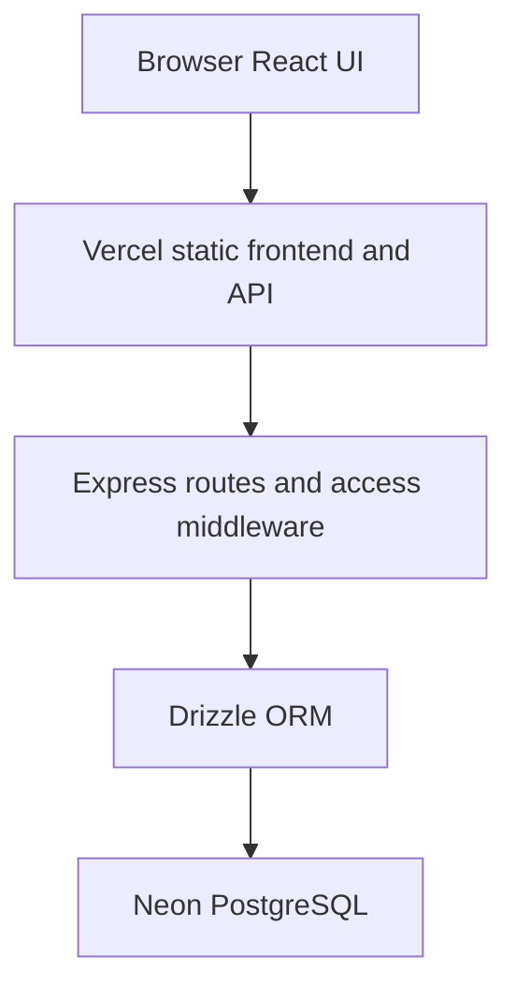

# UniConnect Project Documentation

Edition 1.0 | 29 October 2026 | Source commit 5d3b768

## 1 Project overview

UniConnect is a university learning and communication website. Students join courses, use learning materials, submit assignments, follow deadlines, and discuss coursework. Instructors manage teaching activities, while administrators manage users and courses.

This manual explains how the team can use, run, maintain, and test the combined project. It documents the expanded hosted campus and the separate local baseline retained for the graduation software testing project.

| Document detail | Value |
| --- | --- |
| Edition | 1.0 \| 29 October 2026 |
| Documented source | Git commit 5d3b768 |
| Repository | https://github.com/mohamedhany-44/UniComnect_test |
| Website | https://unicomnect-test.vercel.app |
| Course catalogue | https://unicomnect-test.vercel.app/catalog |
| Audience | Project teammates, testers, developers, and graduation supervisors |

### What is included

The hosted campus has 25 initial courses, including the original Software Testing course and 24 added courses across eight subject categories. The added content includes 144 original PDF study guides, 72 assignments, 24 course announcements, 24 polls, 48 calendar events, and 72 discussion messages. These are initial seeded counts; shared records change as people use the website.

All populated people, enrolments, and academic content are fictional. The site is a shared academic demonstration and testing environment. It is not an official university information system.

### Contents

- [1 Project overview](#1-project-overview)
- [2 Features and user roles](#2-features-and-user-roles)
- [3 User workflows](#3-user-workflows)
- [4 System architecture](#4-system-architecture)
- [5 Database design](#5-database-design)
- [6 Local installation and commands](#6-local-installation-and-commands)
- [7 Configuration and authentication](#7-configuration-and-authentication)
- [8 Identity and course API](#8-identity-and-course-api)
- [9 Coursework and file API](#9-coursework-and-file-api)
- [10 Community and administration API](#10-community-and-administration-api)
- [11 API request examples](#11-api-request-examples)
- [12 Deployment and maintenance](#12-deployment-and-maintenance)
- [13 Testing and graduation evidence](#13-testing-and-graduation-evidence)
- [14 Limitations and source references](#14-limitations-and-source-references)

## 2 Features and user roles

UniConnect uses five application roles. An instructor awaiting approval has the professor/ta role with approval disabled; pending approval is an account state, not a sixth role. The table summarizes the intended interface and workflows, not a claim that every API permission has been exhaustively audited.

| Role in code | Main responsibilities |
| --- | --- |
| student | Join courses, read materials and announcements, vote, chat, submit work, view grades, and maintain a profile. |
| professor/ta | Create and manage teaching courses, publish materials and assignments, grade submissions, and create announcements and events. |
| system_admin | Manage users, approve instructors, manage courses and membership, create administrators, and view statistics pages. |
| class_representative | Use student features, publish class announcements, and assign or remove course heads through the available management routes. |
| course_head | Use student features and maintain materials, announcements, and events for managed courses. |

### Subject categories

| Category | Examples |
| --- | --- |
| Computer Science | Programming Fundamentals; Data Structures and Algorithms |
| Software Engineering | Software Quality and Testing; Graduation Project Studio |
| Data Science and AI | Machine Learning; Natural Language Processing |
| Cybersecurity and Networks | Computer Networks; Web Application Security |
| Business and Management | Entrepreneurship; Project Management |
| Mathematics and Statistics | Calculus I; Linear Algebra |
| Design and Media | Visual Communication; User Experience Design |
| Languages and Communication | Academic English; Technical Writing |

General Studies is also available as the default category for courses without another category. Course creation and editing allow a category and an overview. The catalogue filters the actual course records by category and year and searches names, codes, overviews, and instructors.

Each added course has six resource folders: lecture, sheet, quiz, assignment, tutorial, and textbook. The textbook folder contains an illustrative reading companion, not a copied commercial textbook.

## 3 User workflows

### Student registration and enrolment

Open the website and choose Create account or Sign up. Select Student and enter the required name, email, password, academic year, and student code. Hosted registration requires a password of at least eight characters. Sign in after registration, open Course Catalogue, and select Join course. Once enrolled, open the course to access its materials, announcements, assignments, and members.

### Materials and assignments

Within a course, open Materials and choose a resource folder. Use the view or download controls for a guide. In Assignments, open an assignment, read its description and deadline, upload a supported file, and turn in the submission. Uploading a file and turning in an assignment are separate operations. Revisit the submission to see instructor grades and feedback.

### Instructor approval and teaching

Register with the Professor/TA option. The account cannot sign in until an administrator approves it. After approval, open My Courses, create a course or join an available teaching course, and enter its code, name, academic year, subject category, and overview. Use the course controls to publish materials, create assignments, add announcements or polls, schedule events, and grade submissions.

### Administration and communication

An administrator can open Pending Users to approve instructors, Users to manage accounts, Courses to manage course records and memberships, and Statistics to inspect the available metrics. Students can use Class Announcements and Deadlines Calendar from the sidebar. Course discussion groups are available from Scientific Discussion Groups. Notifications appear through the bell control.

### Profiles and sample accounts

Open Profile to edit personal details, change the profile picture, or change the password. Profile images use the same supported image formats and size limits as other hosted uploads. Shared sample accounts all use UniConnect123!. Use a personal sample account for work you want to keep separate from the shared student account.

| Email | Purpose |
| --- | --- |
| student@uniconnect.test | Populated student workspace |
| student2@uniconnect.test | Second student for ownership checks |
| instructor@uniconnect.test | Populated teaching workspace |
| admin@uniconnect.test | Shared demonstration administrator |
| representative@uniconnect.test | Class representative |
| head@uniconnect.test | Course head |
| pending@uniconnect.test | Instructor approval scenario |

## 4 System architecture

The React single page application calls an Express REST API. Drizzle ORM maps TypeScript schemas to PostgreSQL records. In hosted mode, frontend assets and API requests share one Vercel origin, while Neon stores the persistent database. Local modes use PGlite, an embedded PostgreSQL engine, with a fresh in-memory database at each backend start.



### Main technologies

| Area | Implementation |
| --- | --- |
| Frontend | React 19, TypeScript, Vite, React Router, Tailwind CSS, Radix UI |
| Forms and state | React Hook Form, Zod, TanStack Query, Axios |
| Backend | Node.js 24, Express 5, TypeScript, Drizzle ORM, pg |
| Identity | bcrypt password hashing, JWT access and refresh tokens, cookies |
| Database | Neon PostgreSQL when hosted; PGlite for local modes |
| Tests | Playwright API and browser checks; saved JSON and Markdown reports |

### Repository map

| Location | Responsibility |
| --- | --- |
| frontend/src/pages | Student, instructor, administrator, catalogue, login, and profile pages |
| frontend/src/hooks and providers | Queries, mutations, authentication, theme, and modal state |
| backend/src/routes and controllers | HTTP routing and business operations |
| backend/src/drizzle | Tables, enums, relationships, and database adapter |
| backend/src/middleware/publicHost.ts | Hosted access checks and response sanitization |
| backend/deploy | Hosted SQL, database initialization, and campus seeding |
| backend/qa | Local fixtures, automated tests, reports, and defect register |
| api/index.ts and scripts | Vercel entry point and portable project commands |

Hosted chat, announcements, and polls refresh approximately every ten seconds. Hosted builds disable the original Socket.IO transport. The original local baseline retains Socket.IO behavior.

## 5 Database design

The authoritative schema is defined under backend/src/drizzle. Courses use a text code as their primary identifier; most content entities use UUIDs. Join tables implement enrolment, teaching, management, attachments, votes, and notification delivery.

| Table or group | Purpose and relationships |
| --- | --- |
| users | Names, email, password hash, role, approval, student code, year, and image URL. |
| refreshTokens and sessions | Refresh tokens belong to users. Sessions records daily activity duration by user and date. |
| courses | Code, name, year, department, overview, image, and associated discussion group. |
| enrolledIn and teaches | Connect students and instructors to courses through composite keys. |
| manages and blacklist | Store course head assignments and restricted course membership records. |
| group and message | A course references its discussion group. Messages reference a group and sender. |
| assignment | Belongs to a course and references its assigner; includes deadline and maximum grade. |
| submission | Links a student to an assignment, with turn-in status, timestamps, grade, and feedback. |
| file and hosted_upload | Metadata and download URL are in file. Hosted content, owner, size, and token are in hosted_upload. |
| assignments_files and submissions_files | Attach existing files to assignments and submissions. |
| material | Links a titled resource and category to a course, uploader, and file. |
| announcement and its joins | courses_announcements and classes_announcements associate notices or polls with a course or year. |
| poll-item and vote | Store poll choices and users who voted for a choice. |
| event | Course calendar event with type, deadline, title, and notes. |
| notification and received_notifications | Store notification content, recipients, and read status. |
| app_migration | Records application content migrations such as campus-content-v1. |

### Key relationships

A user can enrol in many courses and a course can have many students. An instructor can teach several courses. Each course has assignments, resources, announcements, events, and a group. Each submission belongs to one student and one assignment and may have multiple attached files.

Deletion behavior depends on each foreign key. Many relationships cascade, but some user and file references restrict deletion. Do not assume every delete is reversible or that deleting a course removes all orphan file metadata.

Academic years are 1 through 5. Event types include quiz, exam, poll, project, assignment, and lab_exam. department is free text rather than a separate normalized department table.

## 6 Local installation and commands

Install Node.js 24 with npm and Git. Reserve ports 3000 and 5173. The initial setup needs internet access to download packages and Chromium. The private repository requires a GitHub invitation and authentication for each teammate.

```text
git clone https://github.com/mohamedhany-44/UniComnect_test.git
cd UniComnect_test
npm install
npm run setup
npm run dev:campus
```

Open http://127.0.0.1:5173 for the populated local campus. The API listens on port 3000. Stop both processes with Ctrl+C. Local data resets when the backend restarts; it does not synchronize with the hosted Neon database.

| Mode | Start or access | Behavior |
| --- | --- | --- |
| Full local campus | npm run dev:campus | Expanded content, registration, uploads, hosted access checks; in-memory data. |
| Original local baseline | npm run dev | One QA course, original defect baseline; frontend at http://localhost:5173. |
| Hosted campus | Public Vercel URL | Persistent shared Neon data; no installation required. |

### Useful commands

| Command | Use |
| --- | --- |
| npm run setup | Install both applications with pinned pnpm lockfiles and install Chromium. |
| npm run build | Compile the backend and build the frontend. |
| npm run test:campus | Run campus API workflows while the full local campus is running. |
| npm run test:campus:public | Run campus API workflows against the public website. |
| npm run test:smoke | Run the original functional API and browser checks. |
| npm test | Run the complete original baseline suite, including defect checks. |
| npm run test:report | Open the generated Playwright HTML report. |
| npm run test:public | Run the smaller public smoke suite. |

Run setup once and after dependency changes. The project helper uses pinned pnpm automatically; do not run npm install inside frontend or backend against their older npm lockfiles. Linux browser tests may need system libraries: from backend, run node node_modules/@playwright/test/cli.js install --with-deps chromium.

Stop local campus servers before running the original baseline suite. Otherwise existing processes or expanded fixtures can contaminate the expected baseline. Windows was exercised; macOS and Linux portability has not been verified by equivalent runs.

## 7 Configuration and authentication

| Variable | Where it applies | Meaning |
| --- | --- | --- |
| DATABASE_URL | Hosted backend and initializer | PostgreSQL connection string. Keep server-side and secret. |
| ACCESS_TOKEN_SECRET | Backend | Secret for 15-minute JWT access tokens. |
| REFRESH_TOKEN_SECRET | Backend | Separate secret for one-day refresh tokens. |
| CLIENT_URL | Backend CORS | Exact frontend origin allowed for credentialed requests. |
| UNICONNECT_PUBLIC_HOST | Backend | Value 1 enables hosted access checks and campus routes; enabled automatically on Vercel. |
| UNICONNECT_LOCAL_QA | Backend | Value 1 selects the local PGlite adapter. Never enable on Vercel. |
| UNICONNECT_CAMPUS | Local launcher | Value 1 adds the expanded campus fixtures in local mode. |
| VITE_SERVER_URL | Frontend build | Local backend origin; empty in hosted builds for same-origin /api calls. |
| VITE_HOSTED | Frontend build | Value 1 enables the hosted uploader, catalogue navigation, and polling behavior. |
| UPLOADTHING_TOKEN | Original external upload mode | Needed only for the original UploadThing integration outside hosted and QA modes. |
| DEMO_PASSWORD | Fresh hosted seed | Optional initial fixture password; existing accounts are not rewritten. |

### Session lifecycle

Login verifies a bcrypt password hash and account approval. A successful response contains an accessToken and safe user data. The server stores a refresh token and sets it in the HttpOnly jwt cookie. The client sends the access token as Authorization: Bearer <accessToken> on authenticated API calls.

GET /api/auth/refresh rotates the refresh token, updates the cookie, and returns fresh authentication data. Hosted cookies are Secure with SameSite=None; local QA uses non-secure SameSite=Lax cookies. The React authentication provider restores sessions and retries selected authentication failures through refresh. Logout clears the session through the API.

### Hosted protections

The hosted middleware checks course membership, submission ownership, teacher permissions, message ownership, and attachment ownership. It binds message senders to the authenticated user and removes password fields recursively from JSON responses. These checks do not represent a complete security certification.

Store secrets in Vercel environment settings or ignored local .env files. Frontend VITE variables are visible to users; never put database credentials or signing secrets in them. The local launcher generates its own session secrets.

## 8 Identity and course API

The base URL is https://unicomnect-test.vercel.app/api when hosted. The local API is http://127.0.0.1:3000/api. All paths below are relative to /api. Braces identify values to substitute; the braces themselves are not part of a request.

| Method | Path | Purpose |
| --- | --- | --- |
| GET | /health | Basic API health response. |
| GET | /catalog | Public course summaries, categories, and sample-data flag. |
| POST | /users/register | Register a student or pending instructor. |
| POST | /auth/login | Sign in and create a refresh session. |
| GET | /auth/refresh | Rotate the cookie-based refresh session. |
| GET | /auth/logout | Sign out. |
| POST | /auth/change-password | Change the signed-in account password. |
| GET, PATCH | /users/me | Read or update the current profile. |
| POST | /users/change-picture | Update the profile image URL after upload. |
| GET | /users/{userId} | Read a user profile. |
| GET | /users/class-members | Read class members. |
| GET | /courses | List courses for an authenticated user. |
| POST | /courses | Create a teaching course as an instructor. |
| GET, PATCH | /courses/{code} | Read or update a course, subject to access checks. |
| POST | /courses/{code}/enrollments | Join a course. |
| POST | /courses/{code}/instructors/me | Join a course as an instructor. |
| GET | /courses/{code}/members | Read course students and instructors. |
| GET | /me/courses/enrolled | Read the current student enrolments. |
| GET | /me/courses/teaching | Read the current instructor courses. |
| POST | /courses/course-head/assign | Assign a course head as a class representative. |
| POST | /courses/course-head/remove | Remove a course head as a class representative. |

### Response and query conventions

The API has several response shapes. Many routes return {message, data}; some return raw arrays or status text. Read the relevant controller before writing a new client. The users listing uses page and per_page; many course and submission endpoints use pageIndex and pageSize. Do not assume one pagination format across all routes.

Hosted public exceptions include login, refresh, logout, health, catalogue, registration, and valid tokenized download URLs. Most remaining API routes require authentication. Public signup does not allow system_admin, class_representative, or course_head roles.

## 9 Coursework and file API

Paths are relative to /api. For the table below, A means /courses/{code}/assignments and S means /courses/{code}/assignments/{assignmentId}/submissions. These are documentation abbreviations, not literal route names.

| Method | Path | Purpose |
| --- | --- | --- |
| GET, POST | A | List assignments or create an assignment as a teacher. |
| GET, PATCH, DELETE | A/{assignmentId} | Read, edit, or delete an assignment. |
| GET, POST | S | Read submissions or create a student submission. |
| PATCH, DELETE | S/{submissionId} | Update turn-in state, grade or feedback, or remove a submission. |
| POST | S/{submissionId}/files | Attach additional uploaded file IDs. |
| DELETE | S/{submissionId}/files/{fileId} | Remove an attached submission file. |
| GET | /materials/course/{code} | List a course resource library. |
| POST | /materials | Publish a resource from an uploaded file. |
| GET, PATCH, DELETE | /materials/{materialId} | Read, edit, or delete a resource. |
| POST | /uploads | Upload hosted PDF or image content as base64 JSON. |
| GET | /content/{fileId}/{token} | Download by unguessable file capability URL. |
| DELETE | /files/{fileId} | Delete an owned hosted upload if database references permit. |
| GET | /events or /me/events | Read events and assignments relevant to the current user. |
| POST | /courses/{code}/events | Create a course event. |
| PATCH, DELETE | /events/{eventId} | Edit or delete an event with the required course permissions. |

### Submissions and grades

Students retrieving their submission supply userId=<their own ID>; teacher views can list submissions for the taught course. Include pageIndex=0&pageSize=10 for a paginated list. Creating a submission uses file_ids. Adding files to an existing submission uses files_ids. Creating an assignment can include attached_files_ids. Field names differ and must be sent exactly.

Students can change their own turn-in status but cannot change grade or feedback. The hosted middleware validates that the course, assignment, and submission belong together. Instructors must teach the course to grade work.

### Hosted upload limits

Supported MIME types are application/pdf, image/png, image/jpeg, and image/webp. The decoded file limit is 1,048,576 bytes. Quotas are 20 MiB per owner and 100 MiB for the application. The server checks file signatures and serializes quota accounting with a PostgreSQL advisory lock. This is basic validation, not malware scanning.

File contents are stored as base64 text in hosted_upload. Download links do not require login once the caller has the full valid URL. Treat the URL as access to that file; do not share it for confidential work. Video uploads are not enabled.

## 10 Community and administration API

Paths below are relative to /api. Role checks in routes and record checks in hostedAccess are cumulative. Interface visibility alone is not authorization.

| Method | Path | Purpose |
| --- | --- | --- |
| GET, POST | /courses/{code}/announcements | Read or publish course notices and polls. |
| GET | /announcements | Read notices for the current student and class. |
| PATCH, DELETE | /announcements/{id} | Edit or remove a notice or poll. |
| POST, DELETE | /poll_items/{id}/votes | Add or remove the current user vote. |
| GET | /groups and /groups/{id} | Read available discussion group information. |
| GET, POST | /groups/{id}/messages | Read or post course group messages. |
| PATCH, DELETE | /groups/{id}/messages/{messageId} | Edit or delete an owned message. |
| GET, PATCH | /notifications | Read notifications or mark them as read. |
| GET | /years/{year}/announcements | Read year announcements. |
| POST | /years/{year}/announcements | Publish as a class representative. |
| GET | /years/{year}/students | Read students for an academic year. |
| GET | /users | Administrator user listing and filters. |
| POST | /users/create or /users/register/admin | Create supported user accounts or an administrator. |
| PUT | /users/{userId}/approve | Approve a pending instructor as an administrator. |
| PUT, DELETE | /users/{userId} | Administrator account editing or deletion. |
| GET, POST | /admin | Administrator course listing or course creation. |
| GET | /admin/{code}/members | Administrator course membership view. |
| DELETE | /admin/{code} or /admin/{code}/users/{userId} | Delete a course or remove a member. |

### Statistics

GET endpoints under /stats include general, students-by-year, most-active-groups, average-course-grades, assignment-completion-rate, daily-users-usage, and session-duration. POST /stats/record-session-duration records activity for the signed-in user.

The statistics interface belongs to the administrator workspace. Several statistics route handlers do not declare an explicit system_admin role guard; hosted authentication must not be mistaken for comprehensive administrator-only API authorization. Review and test those boundaries before using real institutional records.

Administrator users can filter with /users?search=<text>&page=1&per_page=10. Additional filters include role, year, and pending_only=true. Search text should be URL encoded.

## 11 API request examples

These examples describe the hosted JSON contract. In Postman, set a baseUrl variable to https://unicomnect-test.vercel.app and retain the cookie jar. Save accessToken from login and set Bearer authorization on protected requests. Use only synthetic accounts and coursework for shared-site experiments.

### Register and sign in

```text
POST {{baseUrl}}/api/users/register
Content-Type: application/json

{"first_name":"Nadia","parent_name":"Hassan",
 "email":"nadia-example@uniconnect.test",
 "password":"ExamplePass123!","role":"student",
 "year":"3","code":"EXAMPLE-3001"}
```

```text
POST {{baseUrl}}/api/auth/login
Content-Type: application/json

{"email":"student@uniconnect.test",
 "password":"UniConnect123!"}
```

A successful login returns accessToken and user and sets the jwt refresh cookie. GET /api/auth/refresh uses that cookie; the verified implementation returns HTTP 201 for a successful refresh.

### Create a course and upload a file

```text
POST {{baseUrl}}/api/courses
Authorization: Bearer {{instructorAccessToken}}

{"code":"EXAMPLE-301","name":"Example Course",
 "year":"3","department":"Software Engineering",
 "description":"An illustrative course overview."}
```

```text
POST {{baseUrl}}/api/uploads
Authorization: Bearer {{accessToken}}

{"name":"report.pdf","type":"application/pdf",
 "content":"<base64 encoded bytes of an actual PDF>"}
```

The upload response has serverData.file_data.id and ufsUrl. Use the returned file ID when creating a submission with {"file_ids":["<fileId>"]}, then PATCH that submission with {"is_turned_in":true}. The instructor can PATCH {"grade":88,"feedback":"Clear reasoning."} on the same submission URL.

### Errors and status codes

Common responses include 200 or 201 for success; 400 for invalid input; 401 or 403 for authentication or permission failures; 404 for missing or invalid download links; and 413 for exhausted upload quotas. Oversized or invalid decoded files currently return 400. Some errors return text rather than JSON. Inspect Content-Type and do not parse every response as JSON.

## 12 Deployment and maintenance

The configured deployment uses the existing Vercel Hobby project unicomnect-test and Neon Free PostgreSQL database unicomnect-test-db in Frankfurt. These are the configured services for this project, not a guarantee about future provider pricing or quotas. No additional paid service is required by the current implementation.

### Deploy from the repository root

- Import or connect mohamedhany-44/UniComnect_test in Vercel. Use the repository root, not frontend or backend, and the Other framework preset.
- Set DATABASE_URL, separate access and refresh signing secrets, and the exact CLIENT_URL in server environment settings. Never set UNICONNECT_LOCAL_QA on Vercel.
- Keep vercel.json: it installs both applications, runs scripts/vercel-build.mjs, serves frontend/dist, and routes /api requests to api/index.ts.
- The build compiles backend and frontend, builds hosted frontend assets with an empty VITE_SERVER_URL, and runs the PostgreSQL initializer when DATABASE_URL is present.
- Wait for the deployment to become Ready. Open /api/health, sign in, inspect the catalogue, and run npm run test:campus:public.

### Database initialization

backend/deploy/initialize.ts uses a transaction and advisory lock. If the users table is absent it loads the committed QA SQL schema. It applies 001_procedures.sql and 002_full_app.sql, seeds the original fixture only when no users exist, and runs the expanded campus seed only when app_migration lacks campus-content-v1.

The initializer preserves existing user data and marks the content migration after success. Subsequent deployments do not reset the database or recreate deleted seeded records. A failed initialization rolls back its transaction. The reconstructed procedures are new project implementations based on required call signatures, not recovered upstream SQL.

### Operational routine

- Review Vercel build and runtime logs after code changes. Record the deployed Git commit with each verification report.
- Back up PostgreSQL before schema changes or bulk record edits. Confirm the available Neon backup and restore options for the actual account; automated recovery testing is not implemented in this repository.
- Monitor stored file usage and account activity. Quotas protect file storage, but there is no comprehensive abuse prevention or institution-grade user verification.
- Rolling back a Vercel deployment changes application code; it does not reverse database migrations. Check schema compatibility before rollback.
- Keep secrets out of Git and regenerate them only through an intentional maintenance process; rotation invalidates sessions.

The normal npm run build command does not initialize hosted data. The Vercel build script does. For a controlled database-only initialization after installing dependencies, run node --import tsx deploy/initialize.ts from backend with the intended server environment configured.

## 13 Testing and graduation evidence

The project contains distinct evidence sets. Results describe the recorded environment and execution date; they do not prove complete feature coverage or capacity.

| Evidence | Recorded result | Scope |
| --- | --- | --- |
| Original local baseline | 25 passed; 9 failed | 34 UI, functional API, security, and database checks. Historical defect baseline. |
| Expanded local campus | 65 passed; 0 failed | Registration, approval, catalogue, categories, coursework, files, communication, and cleanup. |
| Expanded public campus | 65 passed; 0 failed | Same workflow script against the shared Vercel and Neon deployment. |

The public result was recorded on 29 October 2026 at 17:17 Cairo time. Its source timestamp is 2026-10-29T14:17:52.676Z in backend/qa/reports/CAMPUS-PUBLIC.json. The baseline is historical: do not report its nine failures as nine reproduced defects in the current hosted deployment.

### Run and interpret the checks

```text
# Start full local campus, then use another terminal
npm run dev:campus
npm run test:campus

# Shared hosted workflow checks
npm run test:campus:public

# Original baseline, with local servers stopped first
npm test
npm run test:report
```

The campus script uses Playwright API request contexts. Its 65 checks include status, content, ownership, persistence, and cleanup assertions; they are not 65 independent browser scenarios. It creates temporary student and instructor accounts, a temporary course, files, submissions, chat, polls, and events, then deletes its own records. A script crash can leave test records behind. Use a designated test environment when other users are active.

### Implementation derived requirements and evidence

| Requirement | Existing evidence |
| --- | --- |
| Students can register and join courses | Campus registration, login, enrolment, and catalogue checks. |
| Only approved instructors can teach | Pending login denial, administrator approval, and course creation checks. |
| Coursework and feedback persist | Upload, submission, turn-in, grade, and feedback checks. |
| Users cannot alter another student grade | Hosted ownership and student grade denial checks; historical SEC cases. |
| Communication works for members | Chat sender binding, announcements, polls, calendar, and notifications checks. |

For graduation submission, validate the requirements with the supervisor; add a test plan, role matrix, requirement-to-test traceability, dated exploratory reports, defect tickets, retest evidence, and a final quality assessment. Extend coverage to accessibility, mobile and browser compatibility, concurrency, backup restoration, and sustained performance.

## 14 Limitations and source references

### Current boundaries

- This is a shared demonstration with known sample credentials, including an administrator. Do not treat it as a deployment for confidential university records.
- Local data is ephemeral. Only the hosted PostgreSQL database persists independently of the local computer.
- Hosted uploads support PDFs and selected images up to 1 MiB. Video, object storage, antivirus scanning, and expiring download links are not implemented.
- Hosted discussions and polls use polling rather than live Socket.IO transport. Updates can take roughly ten seconds to appear.
- Department categories are course text fields. The application does not implement a normalized multi-university or faculty hierarchy, tuition payments, attendance, timetables, or a registrar system.
- Public signup does not verify ownership of an institutional email address. A comprehensive password reset service, rate limiting, audit trail, and security review remain outside the verified scope.
- The original baseline retains known defects for testing. Never expose baseline mode as an internet-facing service.
- The saved public workflow checks do not replace full load, accessibility, device, security, or disaster recovery testing.

### Troubleshooting

| Symptom | Action |
| --- | --- |
| Local page does not open | Check that the intended mode is running and ports are free. Use 127.0.0.1:5173 for campus mode. |
| Data disappears after restart | Expected in local PGlite modes. Use the hosted website for shared persistent data. |
| Instructor login rejected | Ask an administrator to approve the account. |
| Upload rejected | Check supported format, decoded size, available quota, and login state. |
| Expected test count changes | Check mode, fixture freshness, shared data, and the exact suite executed. |
| Hosted API or build error | Review Vercel logs, DATABASE_URL, environment secrets, and schema initialization. |

### Source of truth and attribution

Application sources: frontend/src/main.tsx; frontend/src/pages; backend/src/index.ts; backend/src/routes; backend/src/controllers; backend/src/drizzle; backend/src/middleware/publicHost.ts; backend/src/routes/campusRoutes.ts. Setup and deployment: package.json; scripts/manage.mjs; scripts/vercel-build.mjs; vercel.json; backend/deploy/initialize.ts and its SQL files.

Verification sources: backend/qa/campus-smoke.cjs; backend/qa/tests; backend/qa/reports/CAMPUS-PUBLIC.json; CAMPUS-SMOKE.json; BASELINE.md; PACKAGED-VERIFICATION.md; backend/qa/DEFECTS.md. README.md, HOSTED.md, and TESTING.md provide additional operational and historical context.

Original application authors: Moslem Ahmed, Marwan Mohammed, and Abdulrhman Jalal. Original repositories: github.com/MoslemAhmed1/UniConnectFrontEnd and github.com/MoslemAhmed1/UniConnectBackEnd. The combined repository adds portable setup, testing infrastructure, hosted protections, hosting configuration, and populated campus content. It does not relicense upstream source code.
